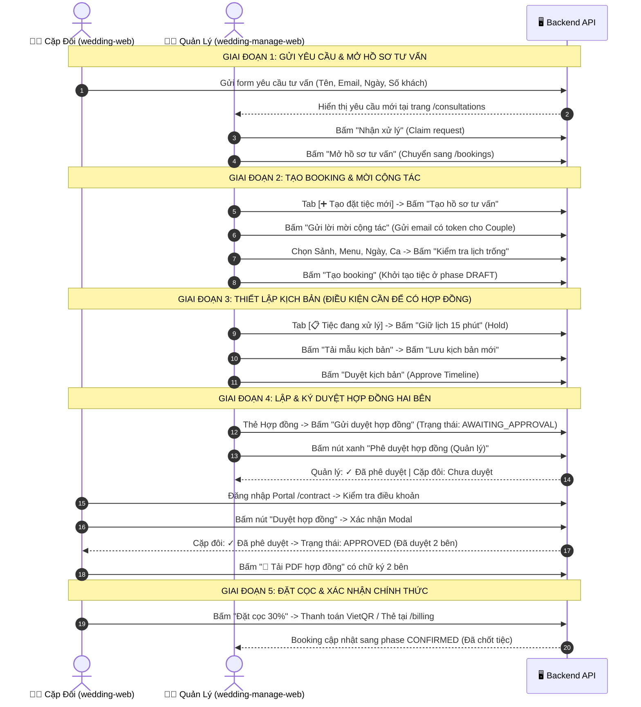

# Hướng Dẫn Kiểm Thử Luồng Đặt Tiệc & Ký Hợp Đồng Giữa Quản Lý và Cặp Đôi

**Hệ thống:** Wedding Estate Platform (`wedding-manage-web` & `wedding-web`)  
**Tài liệu:** Hướng dẫn nghiệp vụ và danh sách thao tác (Action Steps & Button Cheatsheet)

---

## 1. Sơ Đồ Tổng Quan Luồng Nghiệp Vụ (End-to-End Workflow)

---

## 2. Chuẩn Bị Môi Trường Test

1. **Web Admin (Dành cho Quản lý / Điều phối tiệc):**
   - URL: `http://localhost:3001` (hoặc cổng chạy dự án `wedding-manage-web`)
   - Tài khoản: Manager hoặc Staff đã được cấp quyền.
2. **Couple Portal (Dành cho Cặp đôi / Khách hàng):**
   - URL: `http://localhost:3000` (dự án `wedding-web`)
   - Tài khoản: Email của cặp đôi nhận qua lời mời cộng tác hoặc đăng ký tư vấn.

---

## 3. Hướng Dẫn Thao Tác Chi Tiết Từng Bước

### Bước 1: Cặp đôi gửi yêu cầu tư vấn (Couple Portal)

1. Truy cập vào trang chủ hoặc trang liên hệ của khách sạn/trung tâm tiệc cưới (`http://localhost:3000`).
2. Tìm khối **"Đăng ký tư vấn tiệc cưới"**.
3. Điền các trường thông tin:
   - **Tên cặp đôi:** Ví dụ `Hoàng & Mai`
   - **Email liên hệ:** Ví dụ `hoangmai@example.com`
   - **Số điện thoại:** `0912345678`
   - **Ngày mong muốn tổ chức:** Chọn một ngày hợp lệ trong tương lai (cách hiện tại tối thiểu 30 ngày).
   - **Số lượng khách dự kiến:** Ví dụ `250`
   - **Lời nhắn:** `Muốn khảo sát sảnh tiệc và tư vấn gói tiệc cưới hoa tươi.`
4. Bấm nút: **`Gửi yêu cầu tư vấn`**.
5. _Kết quả:_ Hệ thống thông báo gửi thành công và ghi nhận vào cơ sở dữ liệu.

---

### Bước 2: Quản lý tiếp nhận yêu cầu (`/consultations`)

1. Đăng nhập trang Admin (`wedding-manage-web`) và vào menu: **`Hồ sơ tư vấn`** (`/consultations`).
2. Trong danh sách yêu cầu mới (nhãn `NEW`), tìm hồ sơ của cặp đôi `Hoàng & Mai`.
3. Bấm nút: **`Nhận xử lý`** (Claim).
   - _Kết quả:_ Trạng thái chuyển từ `NEW` sang `CONTACTED` và gắn nhân viên phụ trách.
4. Sau khi tư vấn ban đầu, bấm nút: **`Mở hồ sơ tư vấn`**.
   - _Kết quả:_ Trình duyệt tự động chuyển hướng sang màn hình **`Điều phối đặt tiệc`** (`/bookings?consultationId=...`) với toàn bộ thông tin ngày, khách, tên cặp đôi đã được điền sẵn.

---

### Bước 3: Tạo hồ sơ tư vấn, mời cộng tác và tạo booking (`/bookings`)

Tại trang **Điều phối đặt tiệc**, giao diện chia làm 2 tab rõ ràng. Chọn tab **`➕ Tạo đặt tiệc mới`**:

#### 3.1. Tại Bước 01: Hồ sơ tư vấn

1. Kiểm tra lại thông tin: Tên cặp đôi `Hoàng & Mai`, Email `hoangmai@example.com`.
2. Bấm nút: **`Tạo hồ sơ tư vấn`**.
   - _Kết quả:_ Hệ thống sinh mã `consultationId` và huy hiệu xanh: `✓ Đã tạo mã tư vấn tự động chuyển sang Bước 02`.
3. Bấm nút: **`Gửi lời mời cộng tác`** (màu xanh hoặc viền nổi bật).
   - _Kết quả:_ Hệ thống kích hoạt lời mời portal, ghi nhận lịch sử gửi email và cấp quyền đăng nhập cho email cặp đôi.

#### 3.2. Tại Bước 02: Khảo sát sảnh & Tạo booking

1. Bấm nút: **`Tải danh mục đặt tiệc`** (nếu danh mục chưa tự tải).
2. Điền các lựa chọn:
   - **Sảnh tiệc:** Chọn sảnh (VD: `Sảnh Ánh Dương · tối đa 320 khách`).
   - **Thực đơn:** Chọn gói thực đơn định sẵn (VD: `Menu Hoàng Kim - 5.000.000 đ/bàn`).
   - **Ngày tổ chức & Ca tiệc:** Chọn ca `TỐI` (hoặc `TRƯA`).
   - **Quy mô:** Nhập số bàn (VD: `25 bàn`), số khách kế hoạch (VD: `250 khách`).
3. Bấm nút: **`Kiểm tra lịch trống`**.
   - _Kết quả:_ Hệ thống báo: `Khung giờ đang trống.`
4. Bấm nút: **`Tạo booking`**.
   - _Kết quả:_ Hệ thống tạo mã booking mới, hiển thị thông báo `Đã tạo hồ sơ đặt tiệc`. Tab `[📋 Tiệc đang xử lý]` xuất hiện huy hiệu `Đang mở`.

---

### Bước 4: Thiết lập kịch bản (BẮT BUỘC để đủ điều kiện tạo Hợp đồng)

> [!IMPORTANT]
> **Quy tắc nghiệp vụ:** Hệ thống không cho phép ký hợp đồng nếu tiệc cưới chưa có kịch bản chương trình (`Timeline`). Nếu cố tình mở hợp đồng khi chưa có timeline, hệ thống sẽ hiển thị cảnh báo: _"Cần có kịch bản tiệc trước khi lập hợp đồng."_

1. Chuyển sang tab: **`📋 Tiệc đang xử lý`**.
2. **Giữ chỗ tạm thời:** Bấm nút **`Giữ lịch 15 phút`** để đảm bảo sảnh không bị nhân viên khác chọn trùng.
3. **Thêm kịch bản chương trình:**
   - Kéo xuống thẻ **"Kịch bản tiệc"**.
   - Bấm nút: **`Tải mẫu kịch bản`** (Hệ thống tự động điền các mốc chuẩn: _17:30 Đón khách_, _18:30 Khai mạc lễ_, _19:00 Khai tiệc & Nâng ly_, _21:00 Tiễn khách_).
   - Hoặc bấm **`Thêm mốc chương trình`** để tùy biến thời gian và nội dung.
   - Bấm nút: **`Lưu kịch bản mới`**.
   - Bấm nút: **`Duyệt kịch bản`** (Approve timeline).
   - _Kết quả:_ Thẻ kịch bản chuyển sang trạng thái đã duyệt.

---

### Bước 5: Lập hợp đồng và Ký xác nhận hai bên

#### 5.1. Khởi tạo và Gửi duyệt hợp đồng (Từ Quản lý hoặc Cặp đôi)

1. Tại thẻ **"Hợp đồng tiệc cưới"** (nằm ở phần dưới trang `/bookings`):
   - Nếu chưa có bản ghi: Bấm nút **`Lập hợp đồng`** -> Chọn các dòng thực đơn theo số bàn, dịch vụ đi kèm -> Bấm **`Lưu bản nháp`**.
   - Hệ thống hiển thị bảng tóm tắt:
     - Tên Cô dâu & Chú rể
     - Sảnh & Ngày tiệc
     - Tổng giá trị hợp đồng (VND)
     - Tiền đặt cọc cam kết (30%)
     - Trạng thái hiện tại: `Bản nháp (Draft)`.
2. Bấm nút: **`Gửi duyệt hợp đồng`**.
   - _Kết quả:_ Trạng thái hợp đồng chuyển thành: `Chờ hai bên duyệt (AWAITING_APPROVAL)`.
   - Bảng trạng thái hiển thị:
     - `Quản lý (Manager): Chưa duyệt`
     - `Cặp đôi (Couple): Chưa duyệt`

#### 5.2. Quản lý phê duyệt hợp đồng (`wedding-manage-web`)

1. Ngay tại thẻ **Hợp đồng tiệc cưới**, khi trạng thái là `Chờ hai bên duyệt`, xuất hiện nút màu xanh lá:
   - **`Phê duyệt hợp đồng (Quản lý)`**
2. Bấm nút: **`Phê duyệt hợp đồng (Quản lý)`**.
   - _Kết quả:_
     - Thông báo thành công: `Đã ghi nhận phê duyệt hợp đồng từ phía Quản lý.`
     - Trạng thái cập nhật: `Quản lý (Manager): ✓ Đã phê duyệt`.
     - Cặp đôi: `Cặp đôi (Couple): Chưa duyệt`.

#### 5.3. Cặp đôi phê duyệt hợp đồng (`wedding-web`)

1. Cặp đôi mở Portal (`http://localhost:3000`) và truy cập mục: **Hợp đồng tiệc cưới** (`/contract?bookingId=...` hoặc qua menu Không gian tiệc cưới).
2. Xem lại bảng tính tiền, thực đơn, gói in thiệp và điều khoản thanh toán.
3. Cặp đôi thấy nút hành động chính:
   - **`Duyệt hợp đồng`**
4. Bấm nút: **`Duyệt hợp đồng`**.
   - Xuất hiện hộp thoại xác nhận: _"Xác nhận hai bạn đồng ý với toàn bộ nội dung hợp đồng này?"_
   - Bấm **`OK`**.
   - _Kết quả:_
     - Màn hình Portal bắn hiệu ứng pháo hoa chúc mừng (`Celebrate`).
     - Trạng thái hợp đồng đổi thành: **`Đã duyệt (APPROVED)`**.
     - Cả hai cột hiển thị:
       - `Quản lý (Manager): ✓ Đã phê duyệt`
       - `Cặp đôi (Couple): ✓ Đã phê duyệt`

#### 5.4. Tải file PDF lưu trữ

1. Ở cả giao diện Quản lý và Cặp đôi đều xuất hiện nút:
   - **`📄 Tải PDF hợp đồng`**
2. Bấm nút này để tải file `Hop-dong-tiec-[ID].pdf` chính thức về máy tính để in ấn hoặc lưu trữ pháp lý.

---

### Bước 6: Đặt cọc và Chuyển trạng thái chính thức (CONFIRMED)

1. **Phía Cặp đôi (Online Portal):**
   - Sau khi hợp đồng `APPROVED`, xuất hiện nút màu vàng nổi bật: **`Đặt cọc [Số tiền 30%] đ`**.
   - Bấm vào nút để chuyển sang trang `/billing`, quét mã VietQR hoặc nhập thẻ để thanh toán tiền cọc.
2. **Phía Quản lý (Admin Web):**
   - Nếu khách chuyển khoản trực tiếp hoặc nộp tiền mặt tại quầy:
     - Quản lý vào menu **Thanh toán & Thu chi** (`/billing?bookingId=...`).
     - Ghi nhận biên lai thu tiền cọc tại mục **Ghi nhận thu chi**.
3. **Kết quả cuối cùng:**
   - Khi giao dịch đặt cọc hoàn tất, Stepper tiến trình chuyển từ `HELD` sang **`CONFIRMED`** (Đã chốt tiệc cưới).

---

## 4. Bảng Tra Cứu Nhanh Nút Bấm Nghiệp Vụ (Action Buttons Cheatsheet)

| Màn hình                    | Tên Nút Bấm                      | Điều Kiện Xuất Hiện            | Hành Động & Kết Quả                          |
| :-------------------------- | :------------------------------- | :----------------------------- | :------------------------------------------- |
| `/consultations`            | **Nhận xử lý**                   | Request ở trạng thái `NEW`     | Gắn nhân viên, chuyển sang `CONTACTED`       |
| `/consultations`            | **Mở hồ sơ tư vấn**              | Request đã được nhận           | Chuyển sang `/bookings` và prefill dữ liệu   |
| `/bookings` (Tab Tạo mới)   | **Tạo hồ sơ tư vấn**             | Đã nhập Tên & Email            | Cấp `consultationId` và `revision: 1`        |
| `/bookings` (Tab Tạo mới)   | **Gửi lời mời cộng tác**         | Đã có hồ sơ tư vấn             | Gửi email link vào Portal cho cặp đôi        |
| `/bookings` (Tab Tạo mới)   | **Kiểm tra lịch trống**          | Đã chọn sảnh, ngày, ca         | Kiểm tra tính khả dụng của sảnh              |
| `/bookings` (Tab Tạo mới)   | **Tạo booking**                  | Sảnh trống, đủ thông tin       | Tạo booking mới (Phase: `DRAFT`)             |
| `/bookings` (Tab Quản lý)   | **Giữ lịch 15 phút**             | Booking đang ở `DRAFT`         | Khóa sảnh 15 phút tránh bị trùng lặp         |
| `/bookings` (Tab Quản lý)   | **Tải mẫu kịch bản**             | Chưa có kịch bản               | Nạp nhanh các mốc đón khách, khai tiệc       |
| `/bookings` (Tab Quản lý)   | **Lưu kịch bản mới**             | Đã nhập các mốc giờ            | Lưu timeline vào máy chủ                     |
| `/bookings` (Tab Quản lý)   | **Duyệt kịch bản**               | Kịch bản chưa duyệt            | **Đạt điều kiện tiên quyết để tạo Hợp đồng** |
| `/bookings` (Tab Quản lý)   | **Lập hợp đồng**                 | Đã có kịch bản đã duyệt        | Chọn các dòng thực đơn, bàn tiệc, dịch vụ    |
| `/bookings` hoặc Portal     | **Gửi duyệt hợp đồng**           | Hợp đồng đang là `DRAFT`       | Chuyển trạng thái sang `AWAITING_APPROVAL`   |
| `/bookings` (Admin)         | **Phê duyệt hợp đồng (Quản lý)** | Trạng thái `AWAITING_APPROVAL` | Manager ký duyệt hợp đồng                    |
| `/contract` (Couple Portal) | **Duyệt hợp đồng**               | Trạng thái `AWAITING_APPROVAL` | Couple ký duyệt hợp đồng                     |
| Cả 2 giao diện              | **📄 Tải PDF hợp đồng**          | Có hợp đồng                    | Tải file PDF bản in chính thức               |
| Portal (`/contract`)        | **Đặt cọc 30% [Tiền VND]**       | Hợp đồng đã `APPROVED`         | Dẫn sang cổng thanh toán cọc để chốt tiệc    |

---

## 5. Những Điểm Cần Chú Ý Khi Test & Xử Lý Tình Huống

1. **Nếu không thấy nút "Phê duyệt hợp đồng (Quản lý)":**
   - Kiểm tra xem Hợp đồng đã được bấm **"Gửi duyệt hợp đồng"** chưa. Nếu vẫn là `Bản nháp (DRAFT)` thì nút duyệt chưa xuất hiện.
2. **Nếu bấm "Lập hợp đồng" bị báo lỗi:**
   - Kiểm tra xem đã duyệt Kịch bản (`Timeline`) chưa. Quy tắc bắt buộc: Kịch bản phải được duyệt trước khi phát hành hợp đồng.
3. **Khi cần thay đổi thông tin sau khi đã gửi duyệt:**
   - Cặp đôi hoặc Quản lý có thể bấm **`Rút duyệt (Withdraw)`** kèm lý do để đưa hợp đồng quay về bản nháp chỉnh sửa lại.
4. **Tránh lỗi xung đột phiên bản (Stale Revision):**
   - Hệ thống áp dụng cơ chế kiểm soát đồng thời lạc quan (`expectedRevision`). Khi thao tác, không mở 2 tab cùng sửa một hợp đồng để tránh lỗi `STALE_REVISION`.
